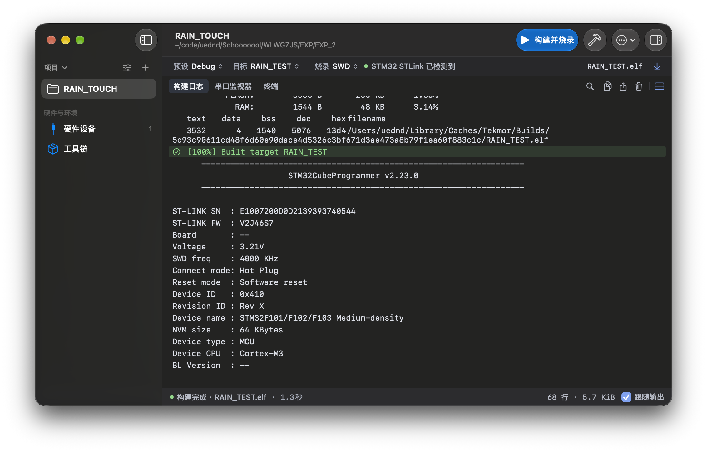

<div align="center">


# Tekmor

由 CubeCLI 驱动的 STM32 工具箱，macOS 原生

**[Ask DeepWiki](https://deepwiki.com/UE-DND/Tekmor)**



</div>

Tekmor 的核心功能仅为串口监控、构建与烧录 STM32 固件。

---

> [!NOTE]
> 1. Tekmor 仅面向 Apple Silicon（`arm64`）架构的 Mac，最低系统要求为 **macOS 15**。
> 2. 使用构建或烧录功能前，需在应用内手动下载并安装相关工具链。

## 从源码构建

- 搭载 Apple Silicon 的 Mac，系统版本为 macOS 15 或更高
- Xcode（支持 Swift 6）

使用 `xcodebuild` 构建 `Tekmor` 应用：

```bash
xcodebuild -project Tekmor.xcodeproj -scheme Tekmor -configuration Debug \
  -destination 'platform=macOS,arch=arm64' -derivedDataPath .build/xcode build
```

## 贡献代码

若发现问题，欢迎任何形式的贡献！无论是修复错误、改进功能，还是提升代码质量，我们都非常欢迎您的参与。
